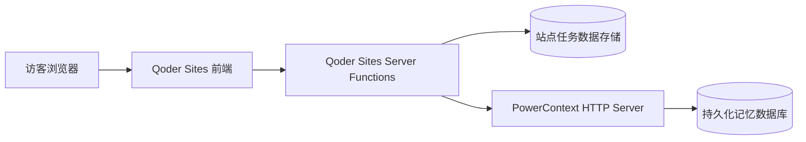

# 部署决策 / 由 Qoder 完成并更新

## 目标拓扑



- 浏览器不能持有 PowerContext Token。
- PowerContext Scope 是数据分区键，不是访问权限；后端必须有可信 session → scope 映射。
- Qoder Sites 自带 DB 只保存笔记/任务/状态；PowerContext 专门保存决策/偏好并支持跨会话查询，两者分工清楚。
- 对外评审站点需能持久访问 PowerContext；`http://127.0.0.1:8000` 仅用于**本地开发**，不能当作 Qoder Sites 线上 Backend 地址。
- 没有可靠的公网 PowerContext 服务，不得用 mock 替换后标注“在线 PowerContext 已通过”。

## 实际部署选项（由 Qoder 确认平台后选一个）

A. Qoder Sites 支持合规独立 Server Runtime：在其中运行官方 PowerContext 包，并实测记忆存取。**必须验证运行时支持 Python、数据持久化及同一访问域/服务器函数调用**，不能凭文档含有 Server Functions 就推断能跑任意 Python daemon。

B. 外部托管完整 PowerContext Server：使用有持久化存储的长期可用主机/容器托管，Qoder Sites Server Functions 私密配置 `POWERCONTEXT_URL` 与服务 Token。Qoder 提供最小一键部署与运维说明，需用户授权托管服务。

C. 若无上述可用条件：公开项目网站只提供站点可运行的基础流程 + 带真实凭据的本地复现说明，明确“公网站点记忆服务尚未连接”。本状态不满足完整技术集成的最好评价；不得伪报。

## 开发时本地 PowerContext 快速安装（官方 current master 方式）

```bash
# 开发端要求 Python 3.11+、git、uv
uv tool install --force "powercontext[cli,server] @ git+https://github.com/oceanbase/powercontext.git@master"
powercontext server run
# 另一个终端
curl --fail --silent --show-error http://127.0.0.1:8000/health/live
python3 qoder/flowmemo/qa/powercontext_smoke.py
```

**必须由 Qoder 自己核查比赛 `2026-competition-ecosystem` 分支与当前 PowerContext API 版本是否兼容；不要覆盖比赛仓库。**

官方文档：https://powercontext.oceanbase.io/en/docs/develop/api-quickstart/
